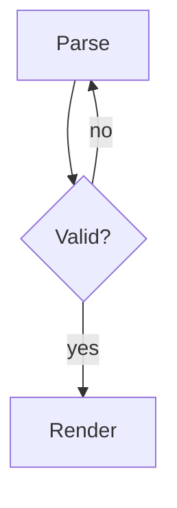

# nocterm_markdown_plus

Render themed markdown in your [nocterm](https://pub.dev/packages/nocterm) terminal app: 19
curated themes, per-element style slots, styled tables, task lists, syntax-highlighted code
blocks, and diff rendering — all out of the box.

nocterm ships a basic `MarkdownText` with a single hardcoded stylesheet. Use this package
when you want your markdown to look *designed*: colors that follow one theme, tables with
real borders, and code blocks with backgrounds.

## Installation

```console
dart pub add nocterm_markdown_plus
```

## Render markdown

Drop `MarkdownPlus` where you would put a `Text` widget. Give it a markdown string and a
theme:

```dart
import 'package:nocterm/nocterm.dart';
import 'package:nocterm_markdown_plus/nocterm_markdown_plus.dart';

void main() {
  runApp(
    NoctermApp(
      home: MarkdownPlus(
        '''
# Release notes

- **New:** themed rendering
- [x] Task list support

```dart
final theme = MarkdownThemes.nord;
```
''',
        theme: MarkdownThemes.nord,
      ),
    ),
  );
}
```

Everything markdown supports is rendered: headings, emphasis, inline code, links,
blockquotes, lists (ordered, nested, task), tables, horizontal rules, and fenced code
blocks. GFM tables and task lists work without extra flags.

Tables go further than the basics: every row is separated by a rule, cell content keeps
its inline markdown (write `**bold**` or `` `code` `` inside a cell), and the delimiter
row controls alignment — `:---` left, `:---:` center, `---:` right:

```md
| Feature | Status | Notes |
|:--------|-------:|:-----:|
| Themes  | done   |   10  |
```

## Pick a theme

19 themes ship with the package. Pass one directly:

```dart
MarkdownPlus(text, theme: MarkdownThemes.catppuccinMocha);
```

The dark gallery is: Catppuccin Mocha, Nord, Dracula, Tokyo Night, One Dark,
Gruvbox Dark, Monokai, GitHub Dark, Ayu Dark, Solarized Dark, **Matrix**
(phosphor green), and nocterm's own default. You can browse all of them in the
bundled gallery:

```console
dart run example/demo.dart
```

Switch themes with `←/→`. The demo renders with every theme applied so you can compare
them in your own terminal before choosing.

## Theme your own way

Every markdown element has its own style slot. Copy a preset and override what you care
about — the rest stays consistent:

```dart
final theme = MarkdownThemes.dracula.copyWith(
  h1Style: const MarkdownStyle.all(Color(0xFFFF79C6)).copyWith(bold: true),
  codeStyle: const MarkdownStyle.all(Color(0x50FA7B)),
);
```

`MarkdownStyle` covers color, background, bold, italic, underline, and strikethrough.
The full slot list lives on [`MarkdownTheme`](lib/src/theme/markdown_theme.dart).

## Match your app's theme

If your app already wraps components in `TuiTheme`, derive markdown colors from it, so
rendered markdown matches the surrounding UI:

```dart
final theme = MarkdownTheme.fromTuiTheme(TuiTheme.of(context));
```

Accent roles are darkened automatically on light themes so headings and links stay
readable. If you need both variants, use an `AdaptiveMarkdownTheme` and resolve it by
brightness:

```dart
final theme = MarkdownThemes.adaptive.first.resolve(brightness);
// or build your own pair:
final pair = AdaptiveMarkdownTheme(
  dark: MarkdownThemes.nord,
  light: MarkdownThemes.githubLight,
);
```

## Code blocks

Code blocks render with the theme's background so they read as one surface with the
page, and **syntax highlighting is on by default**: `SyntaxCoreHighlighter` uses
TextMate grammars (the same ones VS Code uses) mapped onto your theme's syntax slots,
with a graceful plain fallback for unknown languages. If you want plain rendering,
pass the null highlighter explicitly:

```dart
MarkdownPlus(
  text,
  theme: MarkdownThemes.tokyoNight,
  highlighter: const PlainHighlighter(),
  lineNumbers: true, // prefixes each line with its number
);
```

## Diff blocks

Fenced `diff` and `patch` blocks render as colorized diffs: additions in the theme's
green, removals in its red, and hunk headers dimmed:

````md
```diff
- final greeting = 'hello';
+ final greeting = 'hello, world';
```
````

No extra configuration — the `diff` info string selects the renderer.

## Conceal source markers

Set `showMarkers: false` to hide markdown syntax (`#` heading markers, `│` quote bars,
list bullets and numbers) and render clean, final-looking output:

```dart
MarkdownPlus(text, showMarkers: false);
```

## Everything a model emits

The renderer covers what LLM output actually contains — GitHub alerts, footnotes,
emoji shortcodes, definition lists, and autolinks all render out of the box:

```md
> [!WARNING]
> Watch out for the dragons.

Text with a footnote[^1] and :rocket: emoji.

[^1]: Footnotes render at the end.

markdown
: A lightweight markup language.
```

## Streaming into a chat

`MarkdownPlus` memoizes each top-level block, so a growing reply re-renders only
its tail — feed it the text received so far and settled blocks are reused:

```dart
final reply = StringBuffer();
llmTokens.listen((token) {
  reply.write(token);
  setState(() => _text = reply.toString());
});
// ...
MarkdownPlus(_text);
```

## Custom tag rendering

Replace the renderer for any tag without forking the engine — return `null` to keep
the default:

```dart
MarkdownPlus(
  text,
  builders: {
    'table': (element, visitor) => const TextSpan(text: 'your own table'),
  },
);
```

## Quantized colors for 8-bit terminals

Pass `ansi256: true` to snap every theme color to the xterm-256 palette:

```dart
MarkdownPlus(text, ansi256: true);
```

## Mermaid diagrams

Fenced `mermaid` blocks render as terminal diagrams — boxes, edges,
arrowheads and edge labels:

````md

````

Unsupported diagram types fall back to a plain source listing, so nothing
ever breaks.

## A note on colors

Presets use explicit truecolor values (e.g. `#cba6f7`), not ANSI palette indices. That
way the same theme renders identically across terminals instead of picking up whatever
palette your terminal happens to define. Themes are also contrast-audited — every
foreground meets WCAG AA (4.5:1) against its background; you can re-check any change with:

```console
dart run tool/contrast_audit.dart
```

## License

MIT. Includes vendored unicode-width utilities from nocterm (MIT) — see
[LICENSE](LICENSE).
