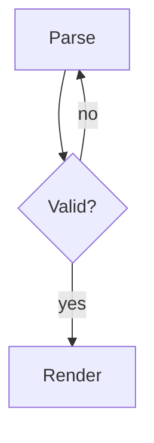

# nocterm_markdown_plus

[](https://github.com/AmidVoshakul/nocterm_markdown_plus/actions/workflows/ci.yml)
[](https://github.com/AmidVoshakul/nocterm_markdown_plus/actions/workflows/release.yml)
[](LICENSE)
[](https://pub.dev/packages/nocterm_markdown_plus)
[](https://pub.dev/packages/nocterm_markdown_plus/score)
[](https://pub.dev/packages/nocterm_markdown_plus/score)
[](https://dart.dev)

Render themed markdown in your [nocterm](https://pub.dev/packages/nocterm) terminal app: 19
curated themes, per-element style slots, styled tables, task lists, syntax-highlighted code
blocks, diff rendering, `NO_COLOR` support, and dimmed output for LLM thinking — all out of the box.

nocterm ships a basic `MarkdownText` with a single hardcoded stylesheet. Drop in
`MarkdownPlus` when you want your markdown to look *designed*: colors that follow one
theme, tables with real borders, and code blocks with backgrounds.

## 🚀 Getting Started

Add the dependency:

```yaml
dependencies:
  nocterm: ^0.9.0
  nocterm_markdown_plus: ^0.1.2
```

Or from the command line:

```console
dart pub add nocterm_markdown_plus
```

## Render markdown

Drop `MarkdownPlus` where you would put a `Text` widget. Give it a markdown string and a
theme, and you get headings, emphasis, inline code, links, blockquotes, lists (ordered,
nested, task), tables, horizontal rules, and fenced code blocks — GFM tables and task
lists work without extra flags:

```dart
import 'package:nocterm/nocterm.dart';
import 'package:nocterm_markdown_plus/nocterm_markdown_plus.dart';

void main() {
  runApp(
    NoctermApp(
      home: MarkdownPlus(
        '''
# Release notes

- **New:** themed rendering
- [x] Task list support

```dart
final theme = MarkdownThemes.nord;
```
''',
        theme: MarkdownThemes.nord,
      ),
    ),
  );
}
```

You can tune tables further than the basics: every row is separated by a rule, cell
content keeps its inline markdown (write `**bold**` or `` `code` `` inside a cell), and
the delimiter row controls alignment — `:---` left, `:---:` center, `---:` right:

```md
| Feature | Status | Notes |
|:--------|-------:|:-----:|
| Themes  | done   |   10  |
```

## Pick a theme

You get 19 themes out of the box. Pass one directly:

```dart
MarkdownPlus(text, theme: MarkdownThemes.catppuccinMocha);
```

The dark gallery is: Catppuccin Mocha, Nord, Dracula, Tokyo Night, One Dark,
Gruvbox Dark, Monokai, GitHub Dark, Ayu Dark, Solarized Dark, **Matrix** (phosphor
green), and nocterm's own default. The light gallery adds Catppuccin Latte, Solarized
Light, GitHub Light, One Light, Ayu Light, and nocterm's light default; an `ascii`
fallback renders literal markers (`**bold**`) with no color at all.

You can browse all of them in the bundled gallery and switch with `←/→`:

```console
dart run example/demo.dart
```

## Theme your own way

Every markdown element has its own style slot, so you can copy a preset and override only
what you care about — the rest stays consistent:

```dart
final theme = MarkdownThemes.dracula.copyWith(
  h1Style: const MarkdownStyle.all(Color(0xFFFF79C6)).copyWith(bold: true),
  codeStyle: const MarkdownStyle.all(Color(0x50FA7B)),
);
```

`MarkdownStyle` covers color, background, bold, italic, underline, and strikethrough.
The full slot list lives on [`MarkdownTheme`](lib/src/theme/markdown_theme.dart).

## Match your app's theme

If your app already wraps components in `TuiTheme`, you can derive markdown colors from
it so rendered markdown matches the surrounding UI:

```dart
final theme = MarkdownTheme.fromTuiTheme(TuiTheme.of(context));
```

Accent roles are darkened automatically on light themes so headings and links stay
readable. If you need both variants, use an `AdaptiveMarkdownTheme` and resolve it by
brightness:

```dart
final theme = MarkdownThemes.adaptive.first.resolve(brightness);
// or build your own pair:
final pair = AdaptiveMarkdownTheme(
  dark: MarkdownThemes.nord,
  light: MarkdownThemes.githubLight,
);
```

## Code blocks

Code blocks render with the theme's background so they read as one surface with the page,
and **syntax highlighting is on by default**: `SyntaxCoreHighlighter` uses TextMate
grammars (the same ones VS Code uses) mapped onto your theme's syntax slots, with a
graceful plain fallback for unknown languages. You can turn it off or add line numbers:

```dart
MarkdownPlus(
  text,
  theme: MarkdownThemes.tokyoNight,
  highlighter: const PlainHighlighter(),
  lineNumbers: true, // prefixes each line with its number
);
```

## Diff blocks

Fenced `diff` and `patch` blocks render as colorized diffs — additions in the theme's
green, removals in its red, hunk headers dimmed — with no extra configuration. The
`diff` info string selects the renderer:

````md
```diff
- final greeting = 'hello';
+ final greeting = 'hello, world';
```
````

## Conceal source markers

Set `showMarkers: false` to hide markdown syntax (`#` heading markers, `│` quote bars,
list bullets and numbers) and render clean, final-looking output:

```dart
MarkdownPlus(text, showMarkers: false);
```

## Everything a model emits

The renderer covers what LLM output actually contains — GitHub alerts, footnotes, emoji
shortcodes, definition lists, and autolinks all render out of the box:

```md
> [!WARNING]
> Watch out for the dragons.

Text with a footnote[^1] and :rocket: emoji.

[^1]: Footnotes render at the end.

markdown
: A lightweight markup language.
```

## Front matter

A leading YAML front matter block (`---` … `---`) is metadata, not prose — it is
skipped by default instead of spilling into the document. Need it back? Pick it up with
a per-tag builder:

```md
---
title: Demo
---
# Rendered content
```

```dart
MarkdownPlus(
  text,
  builders: {
    'front_matter': (element, visitor) =>
        TextSpan(text: element.textContent),
  },
);
```

A `---` first line without a closing `---` stays an ordinary horizontal rule.

## Streaming into a chat

`MarkdownPlus` memoizes each top-level block, so a growing reply re-renders only its
tail — feed it the text received so far and settled blocks are reused:

```dart
final reply = StringBuffer();
llmTokens.listen((token) {
  reply.write(token);
  setState(() => _text = reply.toString());
});
// ...
MarkdownPlus(_text);
```

## Custom tag rendering

You can replace the renderer for any tag without forking the engine — return `null` to
keep the default:

```dart
MarkdownPlus(
  text,
  builders: {
    'table': (element, visitor) => const TextSpan(text: 'your own table'),
  },
);
```

## Quantized colors for 8-bit terminals

Pass `ansi256: true` to snap every theme color to the xterm-256 palette:

```dart
MarkdownPlus(text, ansi256: true);
```

## Mermaid diagrams

Fenced `mermaid` blocks render as terminal diagrams — boxes, edges, arrowheads and edge
labels:

````md

````

Unsupported diagram types fall back to a plain source listing, so nothing ever breaks.

## NO_COLOR

The package honors the [`NO_COLOR`](https://no-color.org) convention: when the
environment variable is set to a non-empty value (including `0`), every
foreground and background colour is dropped to the terminal default — bold,
italic, underline, strikethrough and glyphs are preserved, so structure and
emphasis survive. The check happens at render time through a single choke
point, so it covers every theme slot, diff backgrounds and syntax tokens.

```dart
// Hosts that read their own configuration can override the probe:
NoColor.setOverride(true);
```

Colours emitted by your own per-tag builders are not intercepted — those spans
are yours to style. If you want a fully colourless *and* literal-marker look
(`**bold**`), use `MarkdownThemes.ascii` instead.

## Dimmed rendering

LLM output often mixes a "thinking" section with the final answer. Render the
thinking part ~50% dimmer so it does not compete with the answer, while
keeping the answer at full strength:

```dart
MarkdownPlus(thinkingText, theme: theme.dimmed()); // dimmed
MarkdownPlus(answerText, theme: theme);              // full strength
```

`MarkdownTheme.dimmed({factor})` (and `MarkdownStyle.dimmed`) blend every
colour toward the page background; emphasis flags, glyphs and the page
background itself are preserved. Composes with `quantizedToAnsi256`.

## A note on colors

Presets use explicit truecolor values (e.g. `#cba6f7`), not ANSI palette indices, so the
same theme renders identically across terminals instead of picking up whatever palette
your terminal happens to define. Themes are also contrast-audited — every foreground
meets WCAG AA (4.5:1) against its background; you can re-check any change with:

```console
dart run tool/contrast_audit.dart
```

## 🤝 Contributing

See [CONTRIBUTING.md](CONTRIBUTING.md) for development setup, checks, and pull request
guidelines.

## ⚖️ License

Distributed under the MIT License. Includes vendored unicode-width utilities from
nocterm (MIT) — see [LICENSE](LICENSE).

---

<div align="right">

Created by [Amid Voshakul 🌠](https://github.com/AmidVoshakul)

</div>